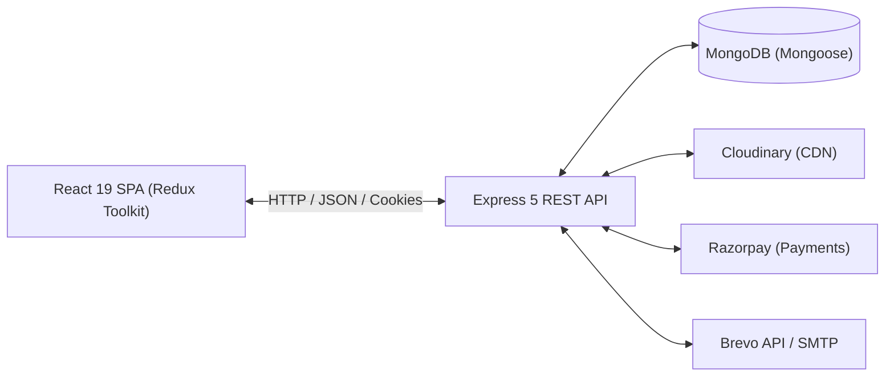

# NexCart

A full-stack MERN e-commerce application featuring JWT authentication, product catalog filtering, Razorpay payment processing, and an administrative management dashboard.

---

## Live Demo

Frontend: https://nexcart-devendra.vercel.app

> [!NOTE]
> Hosted on free tiers: the first load after a period of inactivity can take 30-60 seconds. If you see an error, wait a minute and refresh.

---

## Features

### Customer / User Features
- **Authentication & Security**: Account registration with avatar image upload, credential login with bcrypt-hashed passwords, JWT access & refresh tokens via secure `httpOnly` cookies, and password reset via SHA-256 tokens sent through Nodemailer.
- **Product Discovery**: Case-insensitive keyword search (with regex injection sanitization), category filtering, price and rating sorting, and pagination.
- **Ratings & Reviews**: Submit 1-to-5 star ratings and written reviews; product average ratings and total review counts update dynamically.
- **Cart & State Persistence**: Redux Toolkit cart with `localStorage` persistence, stock validation checks, and quantity management.
- **Checkout & Taxes**: Multi-step checkout pipeline (Shipping Info -> Order Confirmation -> Payment) with automatic server-side price verification, 18% GST calculation, and conditional free shipping above ₹500.
- **Payment Processing**: Integrated Razorpay checkout workflow with server-side HMAC-SHA256 signature verification.
- **Order Management**: Order history view, detailed order invoice inspection, and self-service order cancellation with automatic stock replenishment.

### Administrator Features
- **Admin Dashboard**: Real-time summary of total platform revenue, total product counts, user numbers, and order volumes.
- **Catalog Management**: Create, update, and delete products with multi-image support; automatic upload to Cloudinary and deletion of orphaned remote images.
- **Order Fulfillment**: Review all customer orders, inspect line items, and advance order status (`Processing` -> `Shipped` -> `Delivered`).
- **User Administration**: View all registered users, inspect account details, promote or demote user roles (`user` / `admin`), and delete user profiles (with safeguards against self-deletion).
- **Review Moderation**: View all customer reviews per product and delete inappropriate reviews with automatic recalculation of average ratings.

---

## Tech Stack

| Layer | Technology | Version | Purpose |
| :--- | :--- | :--- | :--- |
| **Frontend Framework** | React | 19.2.4 | Declarative component-based user interface |
| **Frontend Build Tool** | Vite | 8.0.4 | Fast development server and production bundler |
| **State Management** | Redux Toolkit | 2.11.2 | Centralized state management for auth, cart, products, and orders |
| **Client Routing** | React Router | 7.14.1 | Client-side routing and protected route guards |
| **UI Components & Icons**| Material UI (MUI) | 9.0.0 | Pre-built UI components, emotion styling, and system icons |
| **HTTP Client** | Axios | 1.15.0 | Promise-based API requests with global credentials enabled |
| **Notifications** | React Toastify | 11.0.5 | Toast alerts for operations, errors, and status updates |
| **Location Utilities** | Country-State-City | 3.2.1 | Standardized geographic dropdown data for shipping forms |
| **Backend Runtime** | Node.js | >=20.19.0 | JavaScript runtime environment |
| **Web Framework** | Express | 5.2.1 | REST API routing and middleware management |
| **Database & ODM** | MongoDB & Mongoose | 9.3.1 | Document datastore with schema validation and model methods |
| **Authentication** | JWT & Bcrypt | 9.0.3 / 6.0.0 | Stateless tokens and salted password hashing (10 rounds) |
| **File Handling** | Express FileUpload | 1.5.2 | Multipart form-data parser with temporary disk storage |
| **Media Storage** | Cloudinary SDK | 2.9.0 | Cloud media hosting for avatars and product images |
| **Payment Gateway** | Razorpay SDK | 2.9.8 | Payment order creation and cryptographic verification |
| **Email Transport** | Nodemailer (SMTP) and Brevo HTTP API | 8.0.4 / Brevo v3 | Transactional emails for password reset tokens |
| **Development Tooling** | Nodemon & ESLint | 3.1.14 / 9.39.4 | Hot-reloading server utility and code linting |

---

## Architecture Overview

NexCart implements a client-server architecture. The React frontend interacts with the Express REST API via proxied HTTP requests. The API connects to MongoDB for persistent data and coordinates with Cloudinary for media storage, Razorpay for payment operations, and Nodemailer or Brevo for email notifications.



For full details on request lifecycles, authentication flows, and layer responsibilities, see [ARCHITECTURE.md](docs/ARCHITECTURE.md). For live hosting, Vercel rewrites, and keep-alive configuration, see [DEPLOYMENT.md](docs/DEPLOYMENT.md).

---

## Key Technical Highlights

- **Server-Side Pricing & Tax Enforcement**: The backend calculates product subtotal, GST (18%), and shipping charges directly from database records during `createNewOrder`, ensuring client-side tampering cannot alter order values.
- **Two-Token Authentication Architecture**: Short-lived JWT access tokens are paired with long-lived refresh tokens stored in MongoDB and transported via secure, `httpOnly` cookies (`SameSite=Strict`), protecting against XSS and CSRF vulnerabilities.
- **Token Invalidation on Session Termination**: Logging out or resetting passwords unsets the refresh token in MongoDB (`$unset: { refreshToken: 1 }`), preventing reuse of stale tokens.
- **Dual-Provider Email Dispatcher (`EMAIL_PROVIDER`)**: Transparently switches between local SMTP (Nodemailer) and Brevo's HTTPS REST API in production, bypassing cloud host restrictions on outbound SMTP ports (25, 465, 587).
- **Modular Query Processor (`ApiFeatures`)**: Reusable helper encapsulating case-insensitive regex keyword searches (with character escaping), field filters, pagination calculation (`skip`/`limit`), and dynamic sorting.
- **Centralized Error & Exception Pipeline**: Custom `HandleError` class combined with an `asyncHandler` higher-order wrapper routes errors to a single middleware, normalizing Mongoose `CastError`, `ValidationError`, and MongoDB duplicate key (`11000`) errors.
- **Automated Cloudinary Media Management**: Temporary files from `express-fileupload` are flushed from local storage (`public/temp/`) immediately after upload attempts; updating or deleting products and avatars automatically purges previous images from Cloudinary.
- **Inventory Consistency with Cancellation Rollbacks**: Stock levels are validated prior to order creation, decremented upon order placement, and automatically restored to the catalog if an order is cancelled.

---

## Project Structure

```text
mern-e-commerce/
├── backend/
│   ├── config/              # Database, Cloudinary, and Razorpay configuration
│   ├── controller/          # Route controller handlers (User, Product, Order, Payment)
│   ├── middlewares/         # Authentication, authorization, and error handling
│   ├── models/              # Mongoose schemas (User, Product, Order)
│   ├── public/temp/.gitkeep # Preserves upload temp directory across fresh clones
│   ├── routes/              # Express API route declarations
│   ├── utils/               # Helpers (ApiFeatures, asyncHandler, Cloudinary, tokens)
│   ├── app.js               # Express app initialization and global middlewares
│   ├── server.js            # Server entry point, DB connection, and HTTP listener
│   ├── package.json         # Backend dependencies and scripts
│   └── .env.example         # Template for backend environment variables
├── frontend/
│   ├── public/              # Static public assets (icons, banners, favicon)
│   ├── src/
│   │   ├── admin/           # Admin dashboard, product, order, and user views
│   │   ├── cart/            # Cart, checkout steps, and Razorpay payment UI
│   │   ├── components/      # Shared components (Navbar, Footer, Loader, etc.)
│   │   ├── features/        # Redux Toolkit slices (user, product, cart, order, admin)
│   │   ├── orders/          # User order list and order details views
│   │   ├── pages/           # Public pages (Home, Products catalog, Product details)
│   │   ├── routes/          # ProtectedRoute guard wrapper
│   │   ├── store/           # Redux store configuration
│   │   ├── user/            # Auth forms (Login, Register, Password, Profile)
│   │   ├── App.jsx          # Route definitions and user session loader
│   │   ├── index.css        # Global CSS styles
│   │   └── main.jsx         # React DOM root and Redux provider wrapper
│   ├── index.html           # HTML entry point
│   ├── vercel.json          # Vercel SPA routing and /api reverse proxy rewrites
│   ├── vite.config.js       # Vite configuration and dev server reverse proxy
│   └── package.json         # Frontend dependencies and scripts
├── docs/
│   ├── ARCHITECTURE.md      # Detailed system architecture and flows
│   ├── DATABASE.md          # Database schemas, ER diagram, and notes
│   ├── DEPLOYMENT.md        # Production hosting, Vercel/Render topology, and keep-alive specs
│   └── API.md               # API endpoints, query params, and payloads
└── README.md                # Project documentation overview
```

---

## Getting Started

### Prerequisites
- [Node.js](https://nodejs.org/) (Frontend: `^20.19.0 || >=22.12.0`, Backend: `>=20.19.0` as specified in package engines)
- [npm](https://www.npmjs.com/) (v9.0.0 or higher)
- [MongoDB](https://www.mongodb.com/) (local instance running on port 27017 or MongoDB Atlas connection URI)
- [Cloudinary](https://cloudinary.com/) account (for avatar and product image storage)
- [Razorpay](https://razorpay.com/) test mode account (for payment key and secret)

### 1. Clone the Repository
```bash
git clone https://github.com/Devendra-singh-baghel/mern-e-commerce.git
cd mern-e-commerce
```

### 2. Configure Backend Environment
Navigate to `backend/` and copy the example environment file:
```bash
cd backend
cp .env.example config/config.env
```
Open `backend/config/config.env` and populate your credentials:
- Set `DB_URI` to your MongoDB connection string (supports SRV or standard replica set seedlist form).
- Provide `JWT_SECRET_KEY` and `REFRESH_TOKEN_KEY`.
- Configure `CLOUDINARY_NAME`, `API_KEY`, and `API_SECRET`.
- Configure `RAZORPAY_API_KEY` and `RAZORPAY_API_SECRET`.
- Configure `EMAIL_PROVIDER` (`smtp` or `brevo`), along with respective SMTP or Brevo API credentials.

> The frontend requires no environment variables (API calls use relative paths, proxied by Vite locally and rewritten to the backend by Vercel in production).

### 3. Install Dependencies
```bash
# Install backend dependencies
cd backend
npm install

# Install frontend dependencies
cd ../frontend
npm install
```

### 4. Run the Application
Open two separate terminal windows:

**Terminal 1: Start Backend**
```bash
cd backend
npm run dev
# Or for production startup:
npm start
```
The API server will start on `http://localhost:8000` (or the configured `PORT`).

**Terminal 2: Start Frontend**
```bash
cd frontend
npm run dev
```
The Vite development server will start on `http://localhost:5173`. Open this URL in your browser.

### 5. Available NPM Scripts

#### Backend (`cd backend`)
| Script | Command | Purpose |
| :--- | :--- | :--- |
| `npm run dev` | `nodemon server.js` | Starts development server with hot-reload |
| `npm start` | `node server.js` | Starts production server |
| `npm test` | `echo ... && exit 1` | Test suite placeholder |

#### Frontend (`cd frontend`)
| Script | Command | Purpose |
| :--- | :--- | :--- |
| `npm run dev` | `vite` | Starts local development server with HMR |
| `npm run build` | `vite build` | Bundles production assets into `dist/` |
| `npm run preview` | `vite preview` | Previews production build locally |
| `npm run lint` | `eslint .` | Checks for linting and code quality issues |
| `npm run lint:fix` | `eslint . --fix` | Automatically fixes autofixable lint issues |
| `npm run clean` | `node -e ...` | Cross-platform cleanup of the `dist/` folder |
| `npm run build:clean`| `npm run clean && npm run build` | Cleans previous build and creates a fresh build |

> [!NOTE]
> There are no automated seed scripts in the repository. Initial products and categories can be created via the Admin Dashboard (`/admin/product/create`) after registering an admin account.

---

## Environment Variables

| Variable | Scope | Description |
| :--- | :---: | :--- |
| `PORT` | Backend | Port number for Express server (defaults to `8000`). |
| `NODE_ENV` | Backend | Runtime environment (`development` or `production`). Governs secure cookie flags and stack trace output. |
| `DB_URI` | Backend | MongoDB connection URI string (supports standard SRV format `mongodb+srv://...` or standard replica set seedlist string `mongodb://host1,host2,host3/nexcart?tls=true&replicaSet=...&authSource=admin`). |
| `FRONTEND_URL` | Backend | Client URL used to formulate password reset email links (e.g. `http://localhost:5173` or `https://nexcart-devendra.vercel.app`). |
| `CORS_ORIGIN` | Backend | Allowed origin for CORS middleware (e.g. `http://localhost:5173` or `https://nexcart-devendra.vercel.app`). |
| `JWT_SECRET_KEY` | Backend | Cryptographic secret for signing access tokens. |
| `JWT_EXPIRY` | Backend | Expiry duration for access tokens (e.g. `1d`). |
| `REFRESH_TOKEN_KEY` | Backend | Cryptographic secret for signing refresh tokens. |
| `REFRESH_TOKEN_EXPIRY` | Backend | Expiry duration for refresh tokens (e.g. `10d`). |
| `COOKIE_EXPIRY` | Backend | Expiry time for auth cookies in days (e.g. `10`). |
| `EMAIL_PROVIDER` | Backend | Email transport provider (`smtp` or `brevo`). Defaults to `smtp`. |
| `SMTP_SERVICE` | Backend | Email service provider for Nodemailer (e.g. `gmail`), used when `EMAIL_PROVIDER=smtp`. |
| `SMTP_MAIL` | Backend | Sender email address for password reset emails (SMTP), used when `EMAIL_PROVIDER=smtp`. |
| `SMTP_PASSWORD` | Backend | App-specific password for SMTP authentication, used when `EMAIL_PROVIDER=smtp`. |
| `BREVO_API_KEY` | Backend | API Key for Brevo HTTPS email API, used when `EMAIL_PROVIDER=brevo`. |
| `BREVO_SENDER_NAME` | Backend | Sender display name for Brevo emails (defaults to `NexCart`), used when `EMAIL_PROVIDER=brevo`. |
| `BREVO_SENDER_EMAIL` | Backend | Verified sender email address on Brevo, used when `EMAIL_PROVIDER=brevo`. |
| `CLOUDINARY_NAME` | Backend | Cloudinary cloud identifier. |
| `API_KEY` | Backend | Cloudinary API Key. |
| `API_SECRET` | Backend | Cloudinary API Secret. |
| `RAZORPAY_API_KEY` | Backend | Razorpay public Key ID (shared with frontend via `/api/v1/getKey`). |
| `RAZORPAY_API_SECRET` | Backend | Razorpay Key Secret for cryptographic HMAC verification. |

Refer to [backend/.env.example](backend/.env.example) for a placeholder template. The frontend requires no environment variables.

---

## API Overview

The REST API is organized around standard CRUD operations on e-commerce resources under `/api/v1`:
- **Auth & Users (`/api/v1/register`, `/api/v1/login`, `/api/v1/profile`, `/api/v1/admin/users`)**: Authentication, profile management, and admin user administration.
- **Products (`/api/v1/products`, `/api/v1/product/:id`, `/api/v1/product/review`)**: Catalog searching, filtering, reviews, and admin product modifications.
- **Orders (`/api/v1/new/order`, `/api/v1/orders/me`, `/api/v1/admin/orders`)**: Order creation, status updates, cancellations, and stock synchronization.
- **Payments (`/api/v1/payment/process`, `/api/v1/paymentVerification`, `/api/v1/getKey`)**: Razorpay transaction initialization and signature validation.

In addition to resource routes, a lightweight liveness endpoint `GET /health` is mounted at the root path (not under `/api/v1`) without authentication to support keep-alive monitoring and uptime checks.

For complete endpoint tables, parameters, and sample request/response payloads, see [API.md](docs/API.md).

---

## Database

The database is built on MongoDB using Mongoose schemas across three main collections:
- **`users`**: Customer credentials, roles, avatar metadata, and refresh tokens.
- **`products`**: Item details, pricing, inventory stock, and embedded customer reviews.
- **`orders`**: Immutable order item snapshots, shipping addresses, payment status, and order lifecycles.

For the entity-relationship diagram and detailed field specifications, see [DATABASE.md](docs/DATABASE.md).

---

## Deployment

NexCart is deployed across free cloud tiers: the React frontend is hosted on Vercel with rewrites proxying `/api/*` to the Express backend hosted on Render, backed by a MongoDB Atlas cluster. A scheduled keep-alive cron job maintains backend liveness during daytime hours to minimize cold-start latency.

For full architecture topology, Vercel rewrites, Render settings, and keep-alive configuration, see [DEPLOYMENT.md](docs/DEPLOYMENT.md).

---

## Future Improvements

The following improvements are planned for future engineering iterations:
- **Automated Testing Suite**: Introduce unit and integration tests using Vitest/Jest for backend controllers and React Testing Library for frontend components.
- **CI/CD Automation**: Implement GitHub Actions workflows for automated linting, test execution, and deployment previews.
- **Atomic Transactions (`mongoose.startSession`)**: Wrap order creation and stock decrements in MongoDB multi-document transactions to ensure atomicity and rollback safety if inventory updates fail.
- **Refresh Token Rotation**: Implement an active token refresh endpoint (`/api/v1/refresh-token`) to silently renew expired access tokens without re-login.
- **Rate Limiting & Security Hardening**: Add `express-rate-limit` for authentication routes and `helmet` for HTTP response security headers.
- **Caching Layer**: Integrate Redis to cache product catalog queries and reduce database reads on high-traffic endpoints.
- **Structured & Request Logging**: Integrate `pino` and HTTP request logging middleware for structured production diagnostics.
- **Server-Side Payment Computation**: Compute Razorpay transaction amounts strictly on the server rather than trusting client `sessionStorage`.
- **Cold-Start Resilience**: Add frontend retry logic and a "server waking up" status indicator during initial cold-start latency.
- **Route-Based Code Splitting**: Leverage React `lazy` and dynamic imports to split routes and reduce the ~9 MB initial JavaScript bundle.
- **Input Validation Middleware**: Add schema validation (e.g. Zod or Joi) on controller request payloads.
- **Admin Query Pagination**: Implement pagination, search, and filtering for administrative orders and products endpoints.
- **Standardized JSON 404 Handler**: Add a fallback middleware returning `{ success: false, message: "Route not found" }` for undefined endpoints.
- **Uptime Alerting**: Configure automated uptime alerting beyond the keep-alive cron schedule.

---

## Author

- **Name**: Devendra Singh Baghel
- **GitHub**: [Devendra-singh-baghel](https://github.com/Devendra-singh-baghel)
- **LinkedIn**: [devendra-singh-baghel](https://www.linkedin.com/in/devendra-singh-baghel-267023351/)
- **Portfolio**: [devendrabaghel.vercel.app](https://devendrabaghel.vercel.app/)
