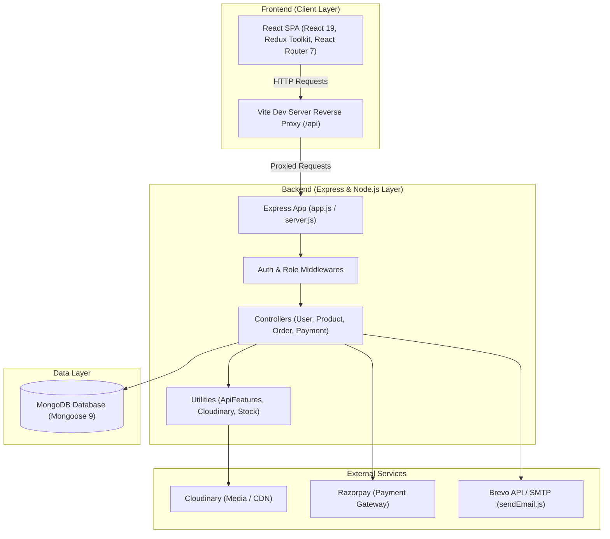
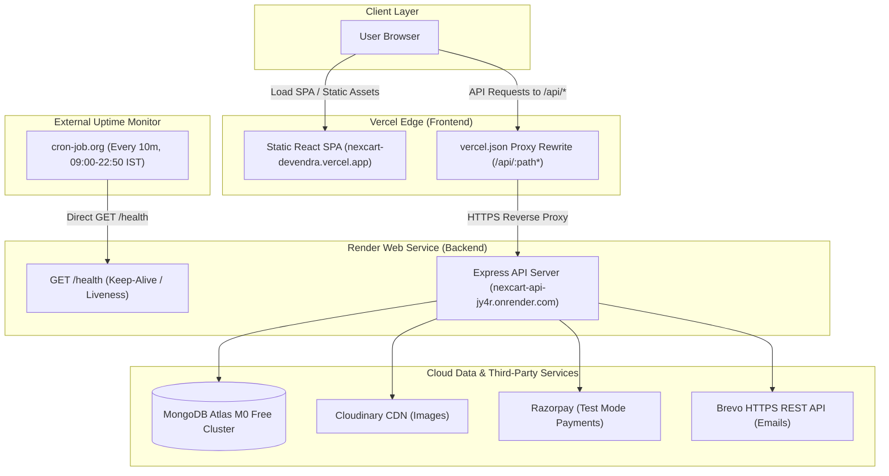
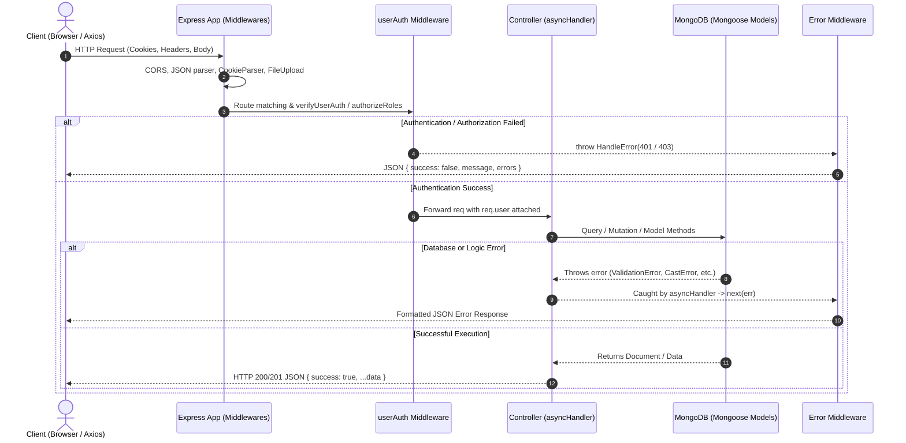
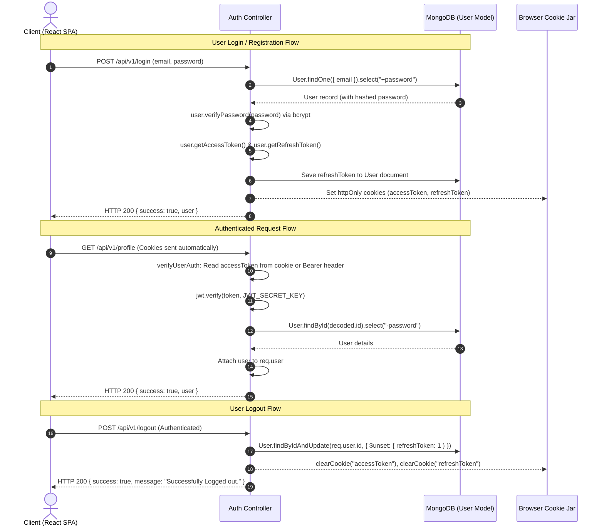

# System Architecture

This document describes the architectural design, request lifecycles, authentication mechanisms, and module responsibilities of NexCart.

---

## High-Level System Architecture

NexCart follows a decoupled client-server architecture. The frontend is a Single Page Application (SPA) built with React and Vite, while the backend is a RESTful API powered by Express and Node.js with MongoDB as the primary datastore. Media storage, payment processing, and transactional emails are offloaded to specialized external cloud services.

### Development Architecture

During local development, the frontend runs on the Vite development server (`http://localhost:5173`), which acts as a local reverse proxy forwarding all `/api` requests to the Express backend (`http://localhost:8000`).

### Production Deployment Topology

In production, the application is deployed across free cloud tiers. The static frontend is hosted on Vercel, the backend API runs as an Express web service on Render, and MongoDB is hosted on MongoDB Atlas.

#### Same-Origin Cookie Preservation in Production
The production frontend (`https://nexcart-devendra.vercel.app`) serves API requests through a reverse-proxy rewrite rule defined in `frontend/vercel.json` (`/api/:path*` -> `https://nexcart-api-jy4r.onrender.com/api/:path*`). Because the client browser dispatches all API calls to the same origin (`nexcart-devendra.vercel.app/api/...`), the HTTP cookies configured with `SameSite=Strict` and `httpOnly: true` are transmitted seamlessly without triggering third-party cookie restrictions or browser cross-site tracking blocks. For a comprehensive operational breakdown, see [DEPLOYMENT.md](DEPLOYMENT.md).

---

## Request Lifecycle

All standard HTTP API requests follow a strict, unidirectional path through Express middleware, controllers, and utility helpers before reaching the database or external services. Asynchronous operations are wrapped in `asyncHandler` to ensure uncaught exceptions are forwarded directly to the centralized error middleware.

> [!NOTE]
> **Liveness Check Exception (`GET /health`)**: Registered at the root path immediately after `const app = express()` in `backend/app.js`, this route executes before CORS, body parsers, cookie parsers, and authentication middleware. It does not query MongoDB, returning a lightweight JSON payload `{ status: "ok", uptime, timestamp }` with `Cache-Control: no-store` to service external keep-alive cron monitors with minimal resource overhead.

---

## Authentication and Authorization Flow

NexCart implements a stateless JWT access token alongside a database-persisted refresh token and cookie-based transport.

### Token Specification
- **Access Token**: Contains user `id` and `email`, signed using `JWT_SECRET_KEY` with expiration `JWT_EXPIRY` (default `1d`).
- **Refresh Token**: Contains user `id`, signed using `REFRESH_TOKEN_KEY` with expiration `REFRESH_TOKEN_EXPIRY` (default `10d`). Stored directly in the `User` document in MongoDB.
- **Cookies**: Both tokens are dispatched via `httpOnly` cookies with `sameSite: "Strict"` (and `secure: true` in production environments).
- **Fallback Extraction**: For non-browser API clients, `verifyUserAuth` checks the `Authorization: Bearer <token>` header if `req.cookies.accessToken` is absent.

---

## Backend Folder Responsibilities

| Directory / File | Responsibility |
| :--- | :--- |
| `backend/server.js` | Main entry point; loads environment variables, initializes database, Cloudinary, and Razorpay connections, configures global process error listeners, and starts the HTTP listener. |
| `backend/app.js` | Configures Express application, registers root `/health` liveness endpoint, registers core middlewares (CORS, JSON/URL-encoded parsers, cookie parser, file upload), mounts resource routers under `/api/v1`, and attaches global error handling. |
| `backend/config/` | Dedicated configuration modules for database connection (`db.js`), Cloudinary client (`cloudinary.config.js`), and Razorpay SDK (`razorpay.config.js`). |
| `backend/controller/` | Business logic for all API endpoints (`user.controller.js`, `product.controller.js`, `order.controller.js`, `payment.controller.js`). |
| `backend/middlewares/` | Express middlewares for authentication and role verification (`userAuth.js`), and centralized error formatting (`error.js`). |
| `backend/models/` | Mongoose schemas, indexes, validation rules, pre-save hooks, and model methods (`user.model.js`, `product.model.js`, `order.model.js`). |
| `backend/routes/` | Express route definitions mapping HTTP paths to controllers with applied auth middlewares (`user.routes.js`, `product.routes.js`, `order.routes.js`, `payment.routes.js`). |
| `backend/utils/` | Reusable utilities: custom error class (`handleError.js`), async controller wrapper (`asyncHandler.js`), query processor (`apiFeatures.js`), Cloudinary upload/deletion helpers (`cloudinary.js`), dual-provider email dispatcher (`sendEmail.js` supporting SMTP and Brevo REST API), token generation (`tokenGenerator.js`), and stock decrement logic (`updateStock.js`). |
| `backend/public/temp/` | Temporary local disk storage directory for uploaded files before streaming to Cloudinary. Tracked via `.gitkeep`. |

---

## Frontend Folder Responsibilities & Structure

| Directory | Responsibility |
| :--- | :--- |
| `frontend/src/admin/` | Admin management views and components (Dashboard, ProductList, CreateProduct, UpdateProduct, OrdersList, UpdateOrder, UsersList, UpdateRole, ReviewList). |
| `frontend/src/cart/` | Shopping cart and checkout components (Cart, CartItem, Shipping, OrderConfirm, CheckoutPath, Payment, PaymentSuccess). |
| `frontend/src/components/` | Shared reusable UI components (Navbar, Footer, Loader, Rating, ImageSlider, Pagination, PageTitle, NoProducts). |
| `frontend/src/features/` | Redux Toolkit slices containing async thunks and reducers (`userSlice.js`, `productSlice.js`, `cartSlice.js`, `orderSlice.js`, `adminSlice.js`). |
| `frontend/src/orders/` | User-facing order history and detail views (`MyOrders.jsx`, `OrderDetails.jsx`). |
| `frontend/src/pages/` | Primary discovery pages (`home/Home.jsx`, `products/Products.jsx`, `product_details/ProductDetails.jsx`). |
| `frontend/src/routes/` | Route access protection components (`ProtectedRoute.jsx`). |
| `frontend/src/store/` | Central Redux store configuration (`store.js`). |
| `frontend/src/user/` | Authentication and account settings views (Login, Register, Profile, UpdateProfile, UpdatePassword, ForgotPassword, ResetPassword, UserDashboard). |

### Routing & Client Access Control
- React Router (`react-router` v7) defines all application routes in `App.jsx`.
- Public routes (`/`, `/products`, `/product/:id`, `/login`, `/register`, `/cart`, `/password/forgot`, `/password/reset/:token`) are accessible to all visitors.
- Protected user routes (`/profile`, `/shipping`, `/order/confirm`, `/process/payment`, `/orders/user`, `/order/:id`) require active authentication; unauthenticated users are redirected to `/login`.
- Protected admin routes (`/admin/*`) require `user.role === 'admin'`; non-admin users attempting access are redirected to the root `/`.

### State Management & Persistence
- **Redux Toolkit**: Centralizes global state for authentication (`user`), product catalog and search (`product`), cart and shipping information (`cart`), customer orders (`order`), and administrative operations (`admin`).
- **Local Storage**: Synchronously caches `cartItems`, `shippingInfo`, user profile object, and `isAuthenticated` flag to persist application state across browser reloads.
- **Session Storage**: Retains temporary checkout calculation totals (`orderItem`) between the confirmation and payment steps.

### API Layer Architecture
- Axios is configured globally in `main.jsx` with `axios.defaults.withCredentials = true` to guarantee cookie propagation on all requests.
- **Local Development**: During development, the Vite dev server acts as a reverse proxy in `vite.config.js`, forwarding all `/api` requests to `http://localhost:8000`.
- **Production Deployment**: In production, Vercel edge routing rules defined in `frontend/vercel.json` rewrite `/api/:path*` to `https://nexcart-api-jy4r.onrender.com/api/:path*`. This ensures the browser treats API requests as same-origin, preserving `SameSite=Strict` `httpOnly` cookie behavior.

---

## Error Handling & Validation Strategy

### Server-Side Error Handling
1. **Standardized Error Class (`HandleError`)**: Extends JavaScript's native `Error` with `statusCode`, `errors` array, and `success: false` flag.
2. **Asynchronous Wrapper (`asyncHandler`)**: Catches rejected promises in controller functions and forwards them directly to Express `next(err)`.
3. **Centralized Error Middleware (`error.js`)**:
   - Parses Mongoose `CastError` (invalid MongoDB ObjectIDs) and returns HTTP 400.
   - Parses Mongoose `ValidationError` and maps individual field validation messages into an `errors` array with HTTP 400.
   - Catches MongoDB duplicate key error code `11000` (e.g. duplicate email) and returns HTTP 409.
   - Restricts stack trace exposure: returns `err.stack` only when `NODE_ENV === "development"`.

### Server-Side Validation
- **Mongoose Schemas**: Enforces data types, string trimming, min/max length limits, numeric ranges, enum whitelisting, and email validation using the `validator` library.
- **Controller-Level Validation**: Explicit checks for required request bodies, password confirmation matching, minimum password lengths (8 characters), and stock availability before completing operations.

### Client-Side Handling
- Redux Toolkit thunks utilize `rejectWithValue` to extract backend error responses (`error.response?.data`).
- Toast notifications (`react-toastify`) surface operation results, warnings, and error messages to users.

---

## Key Design Decisions

1. **Server-Side Pricing and Tax Verification**: Order totals, GST (18%), and shipping charges are calculated strictly on the backend inside `createNewOrder`. The server queries the database for accurate product unit prices rather than trusting client-submitted numbers.
2. **Two-Token Authentication Architecture**: Short-lived access tokens handle routine API authorization, while long-lived refresh tokens are persisted in MongoDB. Refresh tokens are immediately purged via `$unset` upon logout or password reset, preventing replay attacks.
3. **Dual Token Retrieval**: `verifyUserAuth` checks `req.cookies.accessToken` first, but falls back to `req.header("Authorization")`. This supports cookie authentication for web browsers while remaining compatible with external API consumers.
4. **Decoupled Search, Filtering, and Pagination**: The custom `ApiFeatures` class isolates query composition from business controllers. Search keywords are sanitized with regular expression escaping before regex queries are built.
5. **Disk Clean-up on File Uploads**: Avatars and product images pass through local temporary storage (`public/temp/`) before being streamed to Cloudinary. In both success and failure scenarios, `fs.unlinkSync` guarantees local temporary files are deleted.
6. **Stock Restoration on Order Cancellation**: Cancelling an order restores the purchased quantities back to the product inventory in MongoDB.
7. **Dual-Provider Transactional Email Strategy**: `sendEmail.js` dynamically selects between standard SMTP (Nodemailer) and Brevo's HTTPS REST API based on `EMAIL_PROVIDER`. This design solves deployment environment constraints where platform free tiers (such as Render) block outbound SMTP ports (25, 465, 587), allowing seamless local SMTP testing and reliable cloud API delivery in production.
8. **Zero-Middleware Liveness Route**: The `GET /health` endpoint is isolated from all application middlewares and database connections. This ensures uptime monitor pings consume near-zero CPU and memory while avoiding unnecessary MongoDB connection pool usage.
