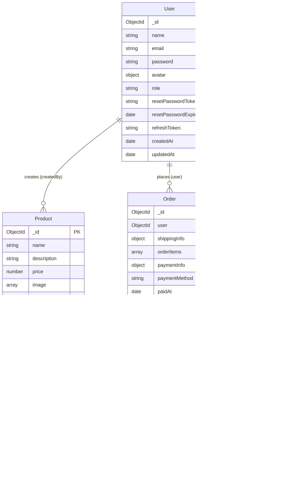

# Database Schema & Data Models

This document provides a comprehensive overview of the MongoDB database schema used in NexCart, derived directly from the application's Mongoose models (`backend/models/`).

---

## Entity-Relationship Diagram

The diagram below represents the collections and the references between them.

> [!NOTE]
> MongoDB collections store both referenced documents (via `mongoose.Schema.ObjectId`) and embedded subdocuments. In the diagram below, solid arrows represent ObjectId references, while internal subdocument structures are detailed in the respective schema tables.

---

## Collection Schemas

### 1. `users` Collection (`backend/models/user.model.js`)

Stores user accounts, credentials, administrative roles, and session tokens.

| Field | Type | Required | Default | Notes / Validation |
| :--- | :--- | :--- | :--- | :--- |
| `_id` | `ObjectId` | Auto | Generated | Primary key. |
| `name` | `String` | Yes | — | Trimmed; length must be between 3 and 25 characters. |
| `email` | `String` | Yes | — | Unique, lowercase, indexed; validated using `validator.isEmail`. |
| `password` | `String` | Yes | — | Minimum 8 characters; excluded from default queries (`select: false`). Hashed with bcrypt (salt rounds: 10). |
| `avatar` | `Object` | Yes | — | Embedded subdocument containing Cloudinary media metadata: |
| `avatar.public_id` | `String` | Yes | — | Cloudinary resource public identifier. |
| `avatar.url` | `String` | Yes | — | Secure delivery URL. |
| `role` | `String` | Yes | `"user"` | Allowed enum values: `["user", "admin"]`. |
| `resetPasswordToken` | `String` | No | `undefined` | SHA-256 hashed password reset token. |
| `resetPasswordExpire`| `Date` | No | `undefined` | Expiration timestamp for password reset token (15-minute validity). |
| `refreshToken` | `String` | No | `undefined` | Active JWT refresh token string for the user session. |
| `createdAt` | `Date` | Auto | Generated | Automatically managed by `timestamps: true`. |
| `updatedAt` | `Date` | Auto | Generated | Automatically managed by `timestamps: true`. |

#### Indexes
- `email`: Unique index (`unique: true, index: true`).

#### Schema Hooks & Instance Methods
- **Pre-Save Hook (`pre("save")`)**: Hashes the password using `bcrypt.hash(this.password, 10)` only when the `password` field is modified.
- **`verifyPassword(userEnteredPassword)`**: Asynchronously compares plain text password against stored hash with `bcrypt.compare`.
- **`getAccessToken()`**: Signs and returns a short-lived JWT containing `{ id, email }` using `JWT_SECRET_KEY` and `JWT_EXPIRY`.
- **`getRefreshToken()`**: Signs and returns a long-lived JWT containing `{ id }` using `REFRESH_TOKEN_KEY` and `REFRESH_TOKEN_EXPIRY`.
- **`getResetPasswordToken()`**: Generates 20 random crypto bytes (hex string), sets SHA-256 hash in `resetPasswordToken`, sets `resetPasswordExpire` to `Date.now() + 15 * 60 * 1000`, and returns the raw token string for email delivery.

---

### 2. `products` Collection (`backend/models/product.model.js`)

Maintains catalog items, stock inventory, categories, ratings, and embedded customer reviews.

| Field | Type | Required | Default | Notes / Validation |
| :--- | :--- | :--- | :--- | :--- |
| `_id` | `ObjectId` | Auto | Generated | Primary key. |
| `name` | `String` | Yes | — | Trimmed product name. |
| `description` | `String` | Yes | — | Trimmed description. |
| `price` | `Number` | Yes | — | Product unit price (max length: 7 digits). |
| `image` | `Array` | Yes | — | Array of embedded subdocuments: |
| `image[].public_id` | `String` | Yes | — | Cloudinary resource ID. |
| `image[].url` | `String` | Yes | — | Cloudinary CDN image URL. |
| `category` | `String` | Yes | — | Trimmed product category string. |
| `stock` | `Number` | Yes | `1` | Available unit inventory (max length: 5 digits). |
| `numOfReviews` | `Number` | No | `0` | Total count of submitted reviews. |
| `avgRatings` | `Number` | No | `0` | Calculated arithmetic mean of all review ratings. |
| `reviews` | `Array` | No | `[]` | Array of embedded customer review subdocuments (detailed below). |
| `createdBy` | `ObjectId` | Yes | — | References `User` collection (`ref: "User"`). |
| `createdAt` | `Date` | Auto | Generated | Automatically managed by `timestamps: true`. |
| `updatedAt` | `Date` | Auto | Generated | Automatically managed by `timestamps: true`. |

#### Embedded Review Subdocument (`reviews[]`)
| Field | Type | Required | Notes / Validation |
| :--- | :--- | :--- | :--- |
| `_id` | `ObjectId` | Auto | Review identifier. |
| `user` | `ObjectId` | Yes | References reviewer's `User` record (`ref: "User"`). |
| `name` | `String` | Yes | Trimmed display name of the reviewer. |
| `rating` | `Number` | Yes | Integer/number constrained between `min: 1` and `max: 5`. |
| `comment` | `String` | Yes | Trimmed review text commentary. |

#### Indexes
- Default `_id` index.

---

### 3. `orders` Collection (`backend/models/order.model.js`)

Captures customer order history, destination shipping addresses, payment details, price breakdowns, and fulfillment status.

| Field | Type | Required | Default | Notes / Validation |
| :--- | :--- | :--- | :--- | :--- |
| `_id` | `ObjectId` | Auto | Generated | Primary key. |
| `user` | `ObjectId` | Yes | — | References purchasing customer in `User` collection (`ref: "User"`). |
| `shippingInfo` | `Object` | Yes | — | Embedded subdocument capturing destination address: |
| `shippingInfo.address` | `String` | Yes | — | Street address. |
| `shippingInfo.city` | `String` | Yes | — | City name. |
| `shippingInfo.state` | `String` | Yes | — | State / province. |
| `shippingInfo.country` | `String` | Yes | — | Country name. |
| `shippingInfo.pinCode` | `Number` | Yes | — | Postal / ZIP code. |
| `shippingInfo.phoneNumber` | `Number` | Yes | — | Contact telephone number. |
| `orderItems` | `Array` | Yes | — | Array of ordered line items (detailed below). |
| `paymentInfo` | `Object` | Yes | — | Embedded payment transaction details: |
| `paymentInfo.id` | `String` | Yes | — | Razorpay payment/order ID or reference ID. |
| `paymentInfo.status` | `String` | Yes | — | Allowed enum values: `["pending", "completed", "failed"]`. |
| `paymentMethod` | `String` | Yes | — | Allowed enum values: `["COD", "Online"]`. |
| `paidAt` | `Date` | No | `null` | Timestamp when payment succeeded (set on online payment or upon delivery for COD). |
| `itemsPrice` | `Number` | Yes | `0` | Subtotal calculated server-side; `min: 0`. |
| `taxPrice` | `Number` | Yes | `0` | Calculated GST amount (18% of itemsPrice); `min: 0`. |
| `shippingPrice` | `Number` | Yes | `0` | Shipping charge (0 if itemsPrice > 500, else 50); `min: 0`. |
| `totalPrice` | `Number` | Yes | `0` | Final total (`itemsPrice + taxPrice + shippingPrice`); `min: 0`. |
| `orderStatus` | `String` | Yes | `"Processing"` | Allowed enum values: `["Processing", "Shipped", "Delivered", "Cancelled"]`. |
| `shippedAt` | `Date` | No | `undefined` | Timestamp recorded when status changes to "Shipped". |
| `deliveredAt` | `Date` | No | `undefined` | Timestamp recorded when status changes to "Delivered". |
| `createdAt` | `Date` | Auto | Generated | Automatically managed by `timestamps: true`. |
| `updatedAt` | `Date` | Auto | Generated | Automatically managed by `timestamps: true`. |

#### Embedded Order Item Subdocument (`orderItems[]`)
| Field | Type | Required | Notes / Validation |
| :--- | :--- | :--- | :--- |
| `_id` | `ObjectId` | Auto | Line item identifier. |
| `name` | `String` | Yes | Product name at time of order creation. |
| `price` | `Number` | Yes | Product unit price at time of order creation. |
| `quantity` | `Number` | Yes | Quantity purchased. |
| `image` | `String` | Yes | Snapshot image URL for the item. |
| `product` | `ObjectId` | Yes | Reference to original catalog item (`ref: "Product"`). |

#### Indexes
- Default `_id` index.

---

## Design Rationale: Embedding vs. Referencing

### Why Embedded Subdocuments Were Used
1. **Historical Immutability (`Order.orderItems`)**: Storing `name`, `price`, and `image` inside the order item preserves an immutable transaction snapshot. If a product’s price changes or the product is later removed from the catalog, previous customer orders remain accurate.
2. **Atomic Reads & High Locality (`Product.reviews`)**: Embedding reviews inside the `Product` document allows fetching a product along with all its customer reviews in a single database read without `$lookup` aggregation joins.
3. **Bounded Datasets (`User.avatar`, `Order.shippingInfo`, `Order.paymentInfo`)**: These structures have a 1:1 relationship with their parent documents and fixed schemas. Embedding avoids collection fragmentation.

### Why ObjectId References Were Used
1. **User Associations (`Product.createdBy`, `Order.user`, `Review.user`)**: Referencing `User` avoids duplicating customer profile data (names, emails, avatars) across multiple collections, maintaining a single source of truth for user accounts.
2. **Inventory Management (`Order.orderItems.product`)**: Referencing `Product` allows the ordering engine to query available inventory before order creation, decrement stock on order placement, and increment stock if an order is cancelled.
