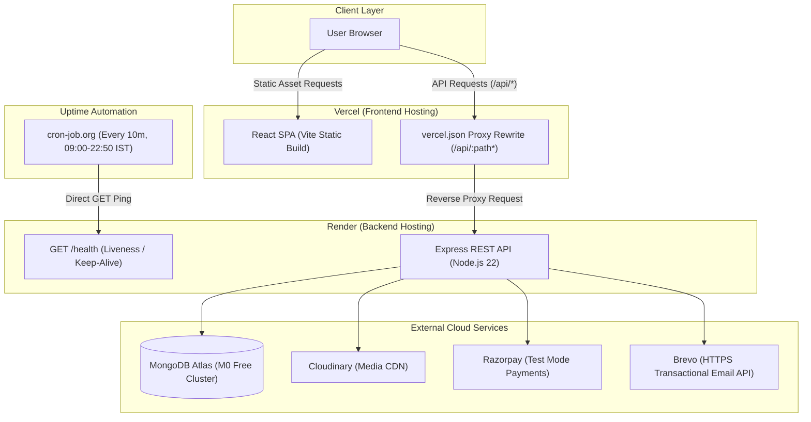
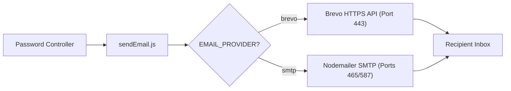

# Production Deployment Guide

This document describes the production deployment topology, service configurations, environment variables, keep-alive monitoring strategy, and operational procedures for NexCart.

---

## Deployment Architecture Overview

NexCart is deployed across free cloud tiers with a decoupled client-server architecture:
- **Frontend**: Hosted on Vercel as a static Single Page Application (SPA), with routing rewrites to proxy API calls and provide HTML5 history fallback.
- **Backend API**: Hosted on Render as an Express.js Web Service on the free tier.
- **Database**: Hosted on MongoDB Atlas as an M0 free tier replica set.
- **Media Assets**: Hosted on Cloudinary CDN for persistent image storage.
- **Payment Processing**: Processed via Razorpay in Test Mode.
- **Transactional Emails**: Dispatched via the Brevo HTTPS REST API to bypass cloud SMTP egress restrictions.
- **Keep-Alive Pings**: Scheduled requests via `cron-job.org` to the root `GET /health` endpoint, intended to reduce cold starts during the daytime.



---

## Live Services Summary

| Component | Platform / Provider | Tier / Plan | URL / Identifier | Purpose |
| :--- | :--- | :--- | :--- | :--- |
| **Frontend** | Vercel | Free (TODO: confirm plan) | `https://nexcart-devendra.vercel.app` | React SPA static hosting and API proxy rewrite. |
| **Backend API** | Render | Free Web Service | `https://nexcart-api-jy4r.onrender.com` | Express REST API application. |
| **Database** | MongoDB Atlas | M0 Free Cluster | Shared 3-node replica set | Primary datastore (`nexcart` database). |
| **Media Storage** | Cloudinary | Free (TODO: confirm plan) | Cloudinary CDN | Persistent storage for user avatars and product photos. |
| **Payment Gateway** | Razorpay | Test Mode | Key ID configured | Checkout order creation and HMAC verification. |
| **Email Service** | Brevo | Free Tier (300 emails/day) | `https://api.brevo.com/v3/smtp/email` | HTTPS transactional email delivery (password resets). |
| **Keep-Alive Monitor**| cron-job.org | Free Tier | Target: `.../health` | Scheduled pings intended to keep the backend awake during the daytime. |

---

## Frontend Deployment (Vercel)

### Configuration Settings
- **Root Directory**: `frontend`
- **Framework Preset**: Vite
- **Build Command**: `npm run build`
- **Output Directory**: `dist`
- **Node Engine Compatibility**: `^20.19.0 || >=22.12.0` (specified in `frontend/package.json`)
- **Environment Variables**: None required on Vercel. All client API calls use relative paths (`/api/v1/...`).

### Vercel Routing Configuration (`frontend/vercel.json`)
The application defines edge routing rules in `frontend/vercel.json` to handle API reverse proxying and client-side routing fallback:

```json
{
  "rewrites": [
    {
      "source": "/api/:path*",
      "destination": "https://nexcart-api-jy4r.onrender.com/api/:path*"
    },
    {
      "source": "/(.*)",
      "destination": "/index.html"
    }
  ]
}
```

### Cookie Transport and Same-Origin Preservation
A critical security advantage of this deployment architecture is same-origin cookie transport:
1. The browser visits `https://nexcart-devendra.vercel.app` and initiates API requests to `/api/v1/...`.
2. Because the request destination is on the same host (`nexcart-devendra.vercel.app`), the browser sends `SameSite=Strict` `httpOnly` authentication cookies without cross-origin or third-party cookie restrictions.
3. Vercel's edge network proxies the request to `https://nexcart-api-jy4r.onrender.com/api/:path*`, transparently forwarding request headers and cookie jars.
4. During local development, this same behavior is replicated by the Vite development server proxy in `frontend/vite.config.js`.

---

## Backend Deployment (Render)

### Service Configuration
- **Environment**: Node
- **Root Directory**: `backend`
- **Build Command**: `npm install`
- **Start Command**: `npm start`
- **Node Engine Compatibility**: `>=20.19.0` (specified in `backend/package.json`)
- **Environment Variable for Runtime Version**: `NODE_VERSION`: a version number such as 22 or 22.12.0

### Environment Variables
Configure the following environment variables in the Render Service Settings dashboard. Do not commit actual secrets to version control.

| Group | Variable Name | Required | Description |
| :--- | :--- | :---: | :--- |
| **Server** | `PORT` | No | Provided automatically by Render, do not set it. |
| **Server** | `NODE_ENV` | Yes | Set to `production`. Suppresses detailed stack traces in API error responses. |
| **Server** | `NODE_VERSION` | Yes | Set to a version number such as 22 or 22.12.0 to configure the Node.js runtime on Render. |
| **Server** | `CORS_ORIGIN` | Yes | Allowed origin for CORS middleware. Must equal the frontend URL exactly: https scheme, no trailing slash (e.g. `https://nexcart-devendra.vercel.app`). |
| **Server** | `FRONTEND_URL` | Yes | Frontend client URL used to formulate password reset email links (e.g. `https://nexcart-devendra.vercel.app`). |
| **Database** | `DB_URI` | Yes | MongoDB connection URI string (supports standard SRV and standard replica set seedlist formats). |
| **Auth** | `JWT_SECRET_KEY` | Yes | Cryptographic secret for signing access tokens. |
| **Auth** | `JWT_EXPIRY` | Yes | Lifespan duration for access tokens (e.g. `1d`). |
| **Auth** | `REFRESH_TOKEN_KEY` | Yes | Cryptographic secret for signing refresh tokens. |
| **Auth** | `REFRESH_TOKEN_EXPIRY`| Yes | Lifespan duration for refresh tokens (e.g. `10d`). |
| **Auth** | `COOKIE_EXPIRY` | Yes | Expiry duration for authentication cookies in days (e.g. `10`). |
| **Email** | `EMAIL_PROVIDER` | Yes | Email transport selection: `brevo` for production or `smtp` for local testing. |
| **Email** | `BREVO_API_KEY` | Yes (if Brevo) | API key for Brevo HTTPS email API. |
| **Email** | `BREVO_SENDER_NAME` | Yes (if Brevo) | Sender display name in outgoing emails (defaults to `NexCart`). |
| **Email** | `BREVO_SENDER_EMAIL`| Yes (if Brevo) | Verified sender email address registered in the Brevo account. |
| **Email** | `SMTP_SERVICE` | Optional | Email service name for Nodemailer (e.g. `gmail`; unused when `EMAIL_PROVIDER=brevo`). |
| **Email** | `SMTP_MAIL` | Optional | Sender email address for SMTP (unused when `EMAIL_PROVIDER=brevo`). |
| **Email** | `SMTP_PASSWORD` | Optional | App-specific password for SMTP authentication (unused when `EMAIL_PROVIDER=brevo`). |
| **Media** | `CLOUDINARY_NAME` | Yes | Cloudinary account cloud name. |
| **Media** | `API_KEY` | Yes | Cloudinary public API key. |
| **Media** | `API_SECRET` | Yes | Cloudinary private API secret. |
| **Payments** | `RAZORPAY_API_KEY` | Yes | Razorpay public Key ID (used for checkout order creation and shared via `/api/v1/getKey`). |
| **Payments** | `RAZORPAY_API_SECRET`| Yes | Razorpay Key Secret for cryptographic HMAC signature verification. |

---

## Database Configuration (MongoDB Atlas)

### Cluster Setup
- **Tier**: M0 Free Tier (Shared RAM, shared vCPU, 512 MB storage limit).
- **Database Name**: `nexcart`.
- **Database User**: Configured with Atlas's built-in role "Read and write to any database".

### Network Access Rule (`0.0.0.0/0`)
- **Configuration**: IP Access List set to `0.0.0.0/0` (Allow Access from Anywhere).
- **Technical Rationale**: Render free web services have no fixed outbound IP, which is why Network Access allows `0.0.0.0/0` and a strong DB password is required. Security is enforced through MongoDB user authentication and TLS encryption.

### Connection String Formats
Both formats are plain MongoDB connection strings accepted natively by the MongoDB driver:

1. **Standard SRV Format (Default)**:
   ```env
   DB_URI=mongodb+srv://<username>:<password>@cluster0.abcde.mongodb.net/nexcart?retryWrites=true&w=majority
   ```
2. **Standard Replica Set Seedlist Format (Fallback)**:
   ```env
   DB_URI=mongodb://<username>:<password>@cluster0-shard-00-00.abcde.mongodb.net:27017,cluster0-shard-00-01.abcde.mongodb.net:27017,cluster0-shard-00-02.abcde.mongodb.net:27017/nexcart?ssl=true&replicaSet=atlas-xxx-shard-0&authSource=admin&retryWrites=true&w=majority
   ```
   > [!TIP]
   > On some networks/machines the Node.js DNS SRV lookup fails (for example `querySrv ECONNREFUSED`); in that case use the standard (non-SRV) connection string from Atlas.

---

## Email Infrastructure in Production

### The Render SMTP Port Block Problem
Cloud hosting platforms on free tiers (including Render) block outbound traffic on standard SMTP ports (`25`, `465`, and `587`) to mitigate automated spam abuse. As a result, standard Nodemailer SMTP connections fail with connection timeouts (`ETIMEDOUT`).

### Dual-Provider Solution (`backend/utils/sendEmail.js`)
To resolve this limitation without changing business logic, `sendEmail.js` includes a provider toggle:
- `EMAIL_PROVIDER="smtp"`: Uses Nodemailer for local development and self-hosted environments.
- `EMAIL_PROVIDER="brevo"`: Sends transactional emails via HTTPS REST calls to the Brevo API (`POST https://api.brevo.com/v3/smtp/email`). HTTPS uses outbound port `443`, which is unrestricted on Render.



### Operational Considerations for Brevo
1. **Verified Sender Address**: `BREVO_SENDER_EMAIL` must match an active, verified sender address in your Brevo account dashboard under "Senders & IP".
2. **API Key Inactivity Expiry**: Brevo automatically deactivates API keys if no emails are sent through them for 90 consecutive days. If key deactivation occurs, generate a new API key in the Brevo dashboard and update `BREVO_API_KEY` in the Render environment settings.
3. **Spam Filtering Notice**: When dispatching emails using free webmail domains without configured custom domain SPF/DKIM DNS records, emails may be classified as Spam or Junk by recipient mail servers. Check the spam folder when testing password reset emails.

---

## Cold Starts, Health Check & Keep-Alive Monitoring

### Render Free Tier Lifecycle
Render free tier web services automatically spin down into a sleeping state after 15 minutes of inbound HTTP inactivity.
- **Cold Start Latency**: The first incoming request after spin-down incurs a 30 to 60+ second boot delay while the container starts, executes `server.js`, and establishes MongoDB connection pools.
- **Proxy Gateway Timeouts (HTTP 502)**: Observed during testing: through the Vercel proxy the first requests after a sleep can return 502 until the service is awake. Refreshing the browser page once the backend container has initialized resolves the connection.

### Root Health Check Endpoint (`GET /health`)
To support external keep-alive monitors, `backend/app.js` exposes a dedicated root endpoint:
- **Mount Point**: `GET /health` (registered directly after `const app = express()`, before CORS, body parsers, cookie parsers, and routers).
- **Execution Cost**: Ultra-lightweight; does not execute database queries, parse request bodies, or load authentication tokens.
- **Response Headers**: `Cache-Control: no-store` to prevent caching by intermediate edge caches or proxies.
- **Response Payload**:
  ```json
  {
    "status": "ok",
    "uptime": 120,
    "timestamp": "2026-11-27T06:05:42.551Z"
  }
  ```

### Keep-Alive Cron Automation
An external cron job on `cron-job.org` keeps the Render service warm during peak hours:
- **Target URL**: `https://nexcart-api-jy4r.onrender.com/health`
- **Schedule**: `*/10 9-22 * * *` (Every 10 minutes from 09:00 to 22:50 IST)
- **Timezone**: `Asia/Kolkata`
- **Request Timeout**: Configured 30 seconds to accommodate cold start container boots.

#### Free Hours Budget Constraint
Render grants 750 free instance hours per calendar month per account:
- Running keep-alive pings continuously (24/7) would consume `24 * 31 = 744` hours, leaving virtually no margin and risking mid-month suspension.
- The 09:00 to 22:50 IST schedule runs for ~14 hours daily, consuming `14 * 31 ≈ 434` hours per month if the service stays awake throughout, which preserves over 300 free instance hours. Outside this schedule the service sleeps normally.

---

## Payments Configuration (Razorpay)

NexCart uses Razorpay exclusively in **Test Mode** for demonstration purposes:
- The backend initializes the Razorpay client in `backend/config/razorpay.config.js` using `RAZORPAY_API_KEY` and `RAZORPAY_API_SECRET`.
- No actual currency transactions occur; payments use Razorpay test card credentials and mock net banking flows.

---

## Manually Verified Deployment Checklist

These items are manual checks, not automated tests:

- [x] register and login
- [x] adding products from the admin area
- [x] cart
- [x] placing an order
- [x] Razorpay test-mode payment
- [x] orders page
- [x] products page
- [x] adding a review
- [x] forgot-password email
- [x] GET /health returns 200 (confirmed in the cron job history)

---

## Known Limitations & Planned Infrastructure Improvements

| Limitation | Impact | Planned Resolution |
| :--- | :--- | :--- |
| **Ephemeral Container Storage** | Local files stored in `backend/public/temp/` do not persist across Render restarts. | Architecture already streams media directly to Cloudinary and purges temp files with `fs.unlinkSync`. |
| **Single Shared Instance** | Render free tier runs a single instance with shared CPU/RAM; no horizontal auto-scaling. | Upgrade to Render Starter / Team plan for horizontal scaling if traffic increases. |
| **Cold Starts Outside 09:00-22:50 IST** | 30-60 second latency on first request after 15 minutes of inactivity outside keep-alive window. | Acceptable for portfolio demonstration; can be eliminated with paid 24/7 web service instance. |
| **Brevo 90-Day Key Dormancy** | Brevo disables API keys after 90 days with zero outgoing emails. | Generate replacement key in Brevo dashboard and update `BREVO_API_KEY` on Render if dormancy occurs. |
| **Lack of Automated Testing / CI** | Regressions must be identified through manual verification. | Implement Jest/Supertest backend tests, React Testing Library frontend tests, and GitHub Actions CI workflow. |
| **No Centralized Log Aggregation** | Server logs rely on ephemeral Render stdout/stderr console. | Integrate Winston/Pino logger with cloud log streaming (e.g., Better Stack or Datadog). |

---

## Redeployment and Maintenance Workflow

### Frontend Updates
1. Push code changes to the `main` branch on GitHub.
2. Vercel automatically detects commits in the `frontend` directory and triggers a preview or production build (`npm run build`).
3. *(TODO: confirm auto-deploy settings in Vercel dashboard)*.

### Backend Updates
1. Push code changes to the `main` branch on GitHub.
2. Render automatically initiates a build (`npm install`) and restarts the service (`npm start`).
3. *(TODO: confirm auto-deploy settings in Render dashboard)*.

### Updating Environment Variables
To update secrets or configuration settings:
1. Navigate to the Render Dashboard -> Select `nexcart-api-jy4r` -> **Environment**.
2. Update the target key-value pair and click **Save Changes**.
3. Render redeploys automatically after an environment variable change.
